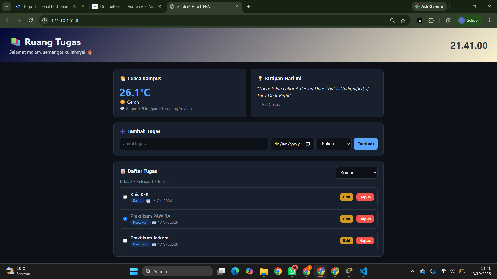

# Ruang Tugas

# Identitas 
- Nama: Sheiryzka Revania Maharani
- NIM : 124140013
- Kelas Praktikum : Pengembangan Aplikasi Website RA

## Deskripsi
Personal dashboard untuk mahasiswa yang menampilkan cuaca,
kutipan motivasi harian, dan manajemen tugas kuliah. Pengguna bisa menambah,
mengedit, menghapus, menandai selesai, dan memfilter tugas. Semua data tugas
disimpan di `localStorage`, sehingga tidak hilang saat halaman di-refresh.

## Fitur Aplikasi
- Tambah, edit, hapus, dan tandai selesai tugas
- Filter tugas (semua / belum selesai / selesai) dan statistik tugas
- Widget cuaca real-time (Open-Meteo API)
- Kutipan harian (DummyJSON API)
- Data tugas awal dari JSONPlaceholder (hanya saat pertama kali dibuka)
- Jam digital dan sapaan otomatis sesuai waktu
- Tampilan responsif

## Screenshot

## Fitur ES6+ yang Diimplementasikan

| Fitur ES6+ | Lokasi di `script.js` |
|------------|-----------------------|
| `let` | baris 208 (`sapaan` di `startClock()`, nilainya berubah sesuai jam) |
| `const` | baris 1, 2, 8, 13, 18, 81, 94, 106, 113, 124, 136, 154, 156, 177, 192, 194, 195, 206, 207, 217, 226–228, 237 |
| Arrow functions | `escapeHTML` (baris 8–11), `formatDate` (baris 13–16), `describeWeather` (baris 18–25), `tick` (baris 205–211), handler event (baris 175, 186, 191), aksi `actions` (baris 196–198), aturan filter (baris 218–220) |
| Template literals | `toHTML()` (baris 41–53), pesan error `fetchJSON()` (baris 107), `fetchWeather()` (baris 125–128), `fetchQuote()` (baris 137), `startClock()` (baris 210), `render()` (baris 230) |
| Async/Await | `init()` (baris 77–90), `fetchJSON()` (baris 105–109), `seedTasks()` (baris 111–120), `fetchWeather()` (baris 122–132), `fetchQuote()` (baris 134–141) |
| Promise (`Promise.allSettled`) | `init()` (baris 89) |
| Classes | `TaskItem` (baris 27–55), `DashboardApp` (baris 57–235), instansiasi (baris 237) |
| Destructuring | parameter constructor (baris 28), `seedTasks()` (baris 114), `fetchWeather()` (baris 124), `fetchQuote()` (baris 136), event submit (baris 177), event click (baris 192) |
| Spread operator | `TaskItem.with()` (baris 37), `addTask()` (baris 144) |
| Default parameters | constructor `TaskItem` (baris 28) |
| Optional chaining `?.` | `actions[action]?.()` (baris 200) |
| Nullish coalescing `??` | `loadTasks()` (baris 94) |
| Optional catch binding | `loadTasks()` (baris 96), `fetchWeather()` (baris 129), `fetchQuote()` (baris 138) |
| Array methods (`map`, `filter`, `find`) | `map`: baris 95, 114, 149, 158, 232; `filter`: baris 165, 222, 228; `find`: baris 154 |

## Penggunaan localStorage

| Operasi | Lokasi di `script.js` |
|---------|-----------------------|
| Cek data tersimpan | baris 81 (`init()`) |
| Membaca data | baris 94 (`loadTasks()`) |
| Menyimpan data | baris 102 (`saveTasks()`) |

## Sumber API Publik
- Cuaca: `https://api.open-meteo.com/v1/forecast`
- Kutipan: `https://dummyjson.com/quotes/random`
- Tugas awal: `https://jsonplaceholder.typicode.com/todos?_limit=5`

## Cara Menjalankan
Buka `index.html` di browser, atau gunakan ekstensi Live Server di VS Code.